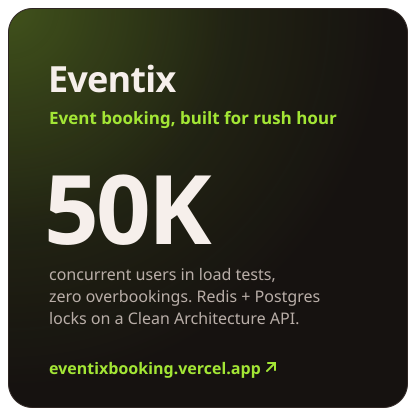

<!-- Artwork in assets/ is generated by scripts/. Edit the data there, not the SVGs.
     No widths are set here: each SVG's width/height is its display size (desktop
     artwork totals 844px, GitHub's column is 846px at 1280px and up). Below 1280px
     the *-mobile.svg layouts take over. Images sit flush with no whitespace between
     tags, and each SVG has a transparent edge, so every gap is even. -->

<a href="https://www.harshbaldaniya.com"><picture><source media="(max-width: 1279px)" srcset="./assets/hero-mobile.svg" /></picture></a>

  
  
  
  
  
  

<a href="https://www.glyphcast.app"><picture><source media="(max-width: 1279px) and (prefers-color-scheme: dark)" srcset="./assets/glyphcast-mobile-dark.svg" /><source media="(max-width: 1279px)" srcset="./assets/glyphcast-mobile-light.svg" /><source media="(prefers-color-scheme: dark)" srcset="./assets/glyphcast-dark.svg" /><source media="(prefers-color-scheme: light)" srcset="./assets/glyphcast-light.svg" /></picture></a><a href="https://eventixbooking.vercel.app"><picture><source media="(max-width: 1279px) and (prefers-color-scheme: dark)" srcset="./assets/eventix-mobile-dark.svg" /><source media="(max-width: 1279px)" srcset="./assets/eventix-mobile-light.svg" /><source media="(prefers-color-scheme: dark)" srcset="./assets/eventix-dark.svg" /><source media="(prefers-color-scheme: light)" srcset="./assets/eventix-light.svg" /></picture></a> <a href="https://brainbox-hb.vercel.app"><picture><source media="(max-width: 1279px) and (prefers-color-scheme: dark)" srcset="./assets/brainbox-mobile-dark.svg" /><source media="(max-width: 1279px)" srcset="./assets/brainbox-mobile-light.svg" /><source media="(prefers-color-scheme: dark)" srcset="./assets/brainbox-dark.svg" /><source media="(prefers-color-scheme: light)" srcset="./assets/brainbox-light.svg" /></picture></a><a href="https://harshos.vercel.app"><picture><source media="(max-width: 1279px) and (prefers-color-scheme: dark)" srcset="./assets/harshos-mobile-dark.svg" /><source media="(max-width: 1279px)" srcset="./assets/harshos-mobile-light.svg" /><source media="(prefers-color-scheme: dark)" srcset="./assets/harshos-dark.svg" /><source media="(prefers-color-scheme: light)" srcset="./assets/harshos-light.svg" /></picture></a>

  
  
  
  

<picture><source media="(max-width: 1279px) and (prefers-color-scheme: dark)" srcset="./assets/toolbox-mobile-dark.svg" /><source media="(max-width: 1279px)" srcset="./assets/toolbox-mobile-light.svg" /><source media="(prefers-color-scheme: dark)" srcset="./assets/toolbox-dark.svg" /><source media="(prefers-color-scheme: light)" srcset="./assets/toolbox-light.svg" /></picture> <a href="https://harshbaldaniya.github.io/HarshBaldaniya/"><picture><source media="(max-width: 1279px) and (prefers-color-scheme: dark)" srcset="./assets/github-mobile-dark.svg" /><source media="(max-width: 1279px)" srcset="./assets/github-mobile-light.svg" /><source media="(prefers-color-scheme: dark)" srcset="./assets/github-dark.svg" /><source media="(prefers-color-scheme: light)" srcset="./assets/github-light.svg" /></picture></a>

<!--START_SECTION:waka-->
<!--END_SECTION:waka-->

<b>Recent activity</b>

 

<!--START_SECTION:activity-->
<!--END_SECTION:activity-->

  <picture>
    <source media="(prefers-color-scheme: dark)" srcset="https://raw.githubusercontent.com/HarshBaldaniya/HarshBaldaniya/output/github-snake-dark.svg" />
    <source media="(prefers-color-scheme: light)" srcset="https://raw.githubusercontent.com/HarshBaldaniya/HarshBaldaniya/output/github-snake.svg" />
    
  </picture>

