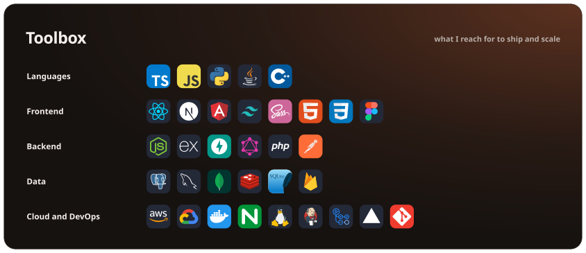

<!-- Artwork in assets/ is generated by scripts/. Edit the data there, not the SVGs.
     Images in a block sit flush (no whitespace between tags): each SVG has an 8px
     transparent edge, so every gap is 16px. Screens up to 767px wide get the
     *-mobile.svg layouts. Keep each block on one line. -->

<a href="https://www.harshbaldaniya.com"><picture><source media="(max-width: 767px)" srcset="./assets/hero-mobile.svg" /></picture></a>

  
  
  
  
  
  

<picture><source media="(max-width: 767px) and (prefers-color-scheme: dark)" srcset="./assets/work-1-mobile-dark.svg" /><source media="(max-width: 767px)" srcset="./assets/work-1-mobile-light.svg" /><source media="(prefers-color-scheme: dark)" srcset="./assets/work-1-dark.svg" /><source media="(prefers-color-scheme: light)" srcset="./assets/work-1-light.svg" /></picture><picture><source media="(max-width: 767px) and (prefers-color-scheme: dark)" srcset="./assets/work-2-mobile-dark.svg" /><source media="(max-width: 767px)" srcset="./assets/work-2-mobile-light.svg" /><source media="(prefers-color-scheme: dark)" srcset="./assets/work-2-dark.svg" /><source media="(prefers-color-scheme: light)" srcset="./assets/work-2-light.svg" /></picture>

  
  
  
  
 
  
  
  
  

<picture><source media="(max-width: 767px) and (prefers-color-scheme: dark)" srcset="./assets/toolbox-mobile-dark.svg" /><source media="(max-width: 767px)" srcset="./assets/toolbox-mobile-light.svg" /><source media="(prefers-color-scheme: dark)" srcset="./assets/toolbox-dark.svg" /><source media="(prefers-color-scheme: light)" srcset="./assets/toolbox-light.svg" /></picture><a href="https://harshbaldaniya.github.io/HarshBaldaniya/"><picture><source media="(max-width: 767px) and (prefers-color-scheme: dark)" srcset="./assets/github-mobile-dark.svg" /><source media="(max-width: 767px)" srcset="./assets/github-mobile-light.svg" /><source media="(prefers-color-scheme: dark)" srcset="./assets/github-dark.svg" /><source media="(prefers-color-scheme: light)" srcset="./assets/github-light.svg" /></picture></a>

<!--START_SECTION:waka-->
<!--END_SECTION:waka-->

<b>Recent activity</b>

 

<!--START_SECTION:activity-->
<!--END_SECTION:activity-->

  <picture>
    <source media="(prefers-color-scheme: dark)" srcset="https://raw.githubusercontent.com/HarshBaldaniya/HarshBaldaniya/output/github-snake-dark.svg" />
    <source media="(prefers-color-scheme: light)" srcset="https://raw.githubusercontent.com/HarshBaldaniya/HarshBaldaniya/output/github-snake.svg" />
    
  </picture>

